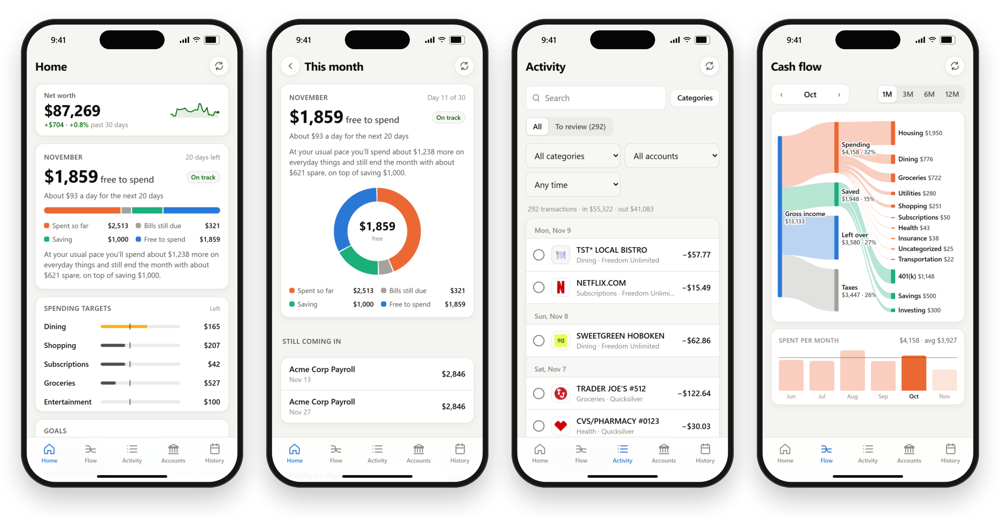
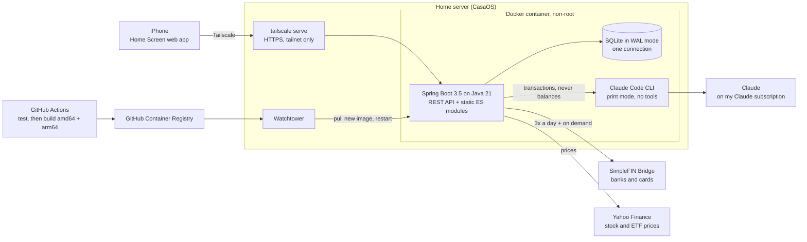

<p align="center">
  
</p>

<h1 align="center">Ledger</h1>

<p align="center">
  <b>A self-hosted personal finance app I built for my iPhone and use every day.</b><br>
  It syncs my bank and card accounts, tells me what's free to spend this month,
  and has Claude read my transactions without ever seeing my balances.
</p>

<p align="center">
  <a href="https://github.com/rjgehan/ledger/actions/workflows/publish.yml"></a>
  
  
  
  
</p>

<p align="center">
  <a href="docs/media/ledger-demo.mp4"></a>
  <br><sub>A short tour; open it for the video with sound. The video and the screenshots use made-up demo data.</sub>
</p>

## At a glance

- **What it is:** a personal finance web app that pulls in my bank and credit card accounts, files every transaction, and answers one question on the Home screen: am I OK this month?
- **In daily use:** it runs on my home server and sits on my iPhone's Home Screen. Every push to `main` is tested, built into a Docker image and rolled out automatically.
- **Engineering:** Java 21 / Spring Boot 3.5 on SQLite, a vanilla-JS front end with no build step, bank sync that handles pending charges changing ids and banks that silently stop updating, and CI/CD from GitHub Actions to a home server.
- **Claude:** wired in through the Claude Code CLI and a hand-written MCP server behind its own OAuth 2.1, and never shown a balance.

<p align="center">
  
  <br><sub>Home, This month, Activity and Cash flow.</sub>
</p>

## What it does

- **Home:** net worth and its direction, what's free to spend for the rest of the month, the spending targets getting tight, savings goals, and Claude's note for the day.
- **This month:** a forecast instead of a budget. Pay still coming is counted in, bills still due and the savings target come off, and the rest is free to spend, with my usual pace of everyday spending checked against it.
- **Activity:** every transaction, searchable, with a "To review" list for new charges, rules that file merchants automatically, my own categories, and one-off purchases (a couch after a move) that stay out of the monthly averages.
- **Cash flow:** a Sankey from income to every category, over 1, 3, 6 or 12 months.
- **History:** a score out of 100 for each month (money kept, targets kept, net worth, steadiness) and a calendar of how net worth moved.
- **Detected automatically:** subscriptions and other recurring charges, paychecks and their rhythm (weekly, every other week, twice a month, monthly), and spending targets prefilled from what I actually spend. Rent and loans get a month-by-month view of their own.
- **Investments:** brokerage and retirement accounts valued from their holdings, priced a few times each trading day.
- **Claude:** a short note every morning, charges worth a second look (a double charge, a price rise, a trial that turned paid), rules and target changes to approve, a Sunday recap, a monthly review, and an Ask box ("Can I afford a $200 concert?").
- **Private by default:** balances are hidden every time the app opens and hide again after two minutes in the background. While hidden, accounts show how much they moved, not how much is in them.

## Architecture



## How it's built

### Claude sees spending, never balances

I wanted useful notes about my money without handing a model the numbers that matter most.

- The app builds everything Claude reads itself, mostly from one class, [`AssistantTools`](src/main/java/cloud/gehan/finance/service/assistant/AssistantTools.java): eight read-only lookups over transactions and what's worked out from them. None returns a balance, net worth or an investment's value, and a goal that tracks a balance reports only its percent complete.
- The lookups also leave out anything a balance could be worked out from: interest and dividends (with the bank's published rate, they give the balance away) and rows on savings, brokerage and retirement accounts.
- On top of the lookups, the morning run gets the uncategorized rows to file, the category names and which accounts have stopped updating (names and dates only). The Ask box gets a one-line-per-row ledger with the same exclusions.
- [Claude Code](src/main/java/cloud/gehan/finance/service/insights/ClaudeCode.java) runs as a subprocess in print mode with no tools at all (`--tools ""`, `--strict-mcp-config`, no settings, skills or slash commands), a JSON Schema for its answer, and a cleared environment that holds its own token and none of the app's secrets. One run at a time, first come first served, with a four-minute timeout that kills the process tree.
- Numbers don't rest on the model's arithmetic. In the Ask box, Claude cites transaction ids; the app looks them up and adds them up itself.
- Changes wait for me. Suggested rules, targets and one-offs arrive as cards to approve. Claude files only the transactions nothing else could, and each line of its reply is checked against known ids and categories.
- The same eight lookups are also an MCP server I wrote by hand ([`McpController`](src/main/java/cloud/gehan/finance/web/McpController.java): stateless Streamable HTTP, JSON-RPC, no SDK), so Claude Code or a claude.ai connector can query the app directly. Requests that carry a browser `Origin` are refused, as a guard against DNS rebinding.
- In front of it is my own OAuth 2.1 server ([`ClaudeOAuth`](src/main/java/cloud/gehan/finance/service/assistant/ClaudeOAuth.java), no Spring Authorization Server): dynamic client registration, PKCE with S256 only, one-hour access tokens, refresh tokens that rotate on every use, tokens stored only as SHA-256 hashes, and redirects only to Claude's own addresses or localhost.
- It runs on my Claude subscription through `claude setup-token`, so there's no API key, and the token is encrypted at rest. The Docker build installs a pinned Claude Code release and copies its native binary, so the runtime image needs no Node.

### Bank sync that survives real bank data

SimpleFIN Bridge connects the banks. Most of the work is in handling what real feeds actually send ([`SyncService`](src/main/java/cloud/gehan/finance/service/SyncService.java)).

- **Incremental pulls** three times a day and on demand, re-reading 14 days before the last clean sync to catch late postings.
- **Pending to posted:** SimpleFIN gives the posted charge a new id. Whatever I did to the pending one (its category, a note, checking it off, marking it one-off) moves to its posted twin: same account and direction, a few days apart, and within a quarter of the amount, which leaves room for a tip.
- **A success that isn't:** a pull can return 200 while one bank behind the bridge has stopped updating. A checking or card account with nothing new for three days is called out on screen and in Claude's notes, and the next pull reaches back to where it stopped, so the missed days come back.
- **No verdicts on missing data:** last month's review is held back while any checking or card account stopped updating before the month ended, and while one is behind, the Ask box is told to answer "careful" rather than "yes" to whether something is affordable.
- **Transfers:** $500 out of checking on the 3rd and $500 into savings on the 4th are paired, so they count as saving instead of spending plus income. Only guessed categories are rewritten, so a $50 grocery run never pairs with a $50 Venmo.
- **Rules** match whole words through the punctuation, dates and reference numbers banks add: `ACME INC` finds `ACME, INC. 1015 PAYROLL`, and `RENT` doesn't match `CURRENT`.
- Anything SimpleFIN doesn't reach comes in as an OFX, QFX, QBO or CSV statement. Importing the same file twice adds nothing.

### Deploys that can't ship a red build

A push to `main` is the whole release process ([`publish.yml`](.github/workflows/publish.yml)).

- GitHub Actions runs the tests and parses every front-end module. The image job `needs` the test job, so a failing run never becomes the image the server pulls. A newer push cancels a publish still in progress, so the newest commit is the one that ships.
- The image is built for amd64 and arm64. Maven runs only on the build platform (the jar is architecture-independent), so it never runs under QEMU, and it resolves dependencies in a step of its own, so a code-only change reuses the cached download. Each image is tagged `latest` and with its commit SHA.
- Watchtower on the server pulls the new image and restarts the container. The container runs as a non-root user with `no-new-privileges`, a health check and a memory limit.
- Restarts don't sign the phone out. HTTP sessions are saved to the data volume. Remember-me uses Spring Security's rotating tokens stored in SQLite, not the default cookie signed with the password hash: a password from the environment is re-hashed with a fresh salt on every start, which would void that cookie on every deploy. An open app notices the server's new start time and reloads its screens.

### A web app that behaves like an iPhone app

No App Store and no build step: plain ES modules served by Spring Boot, added to the Home Screen from Safari.

- Standalone manifest, safe-area insets, light and dark themes, tabular figures, swipe an account row left to hide it (as in Mail), and tapping the current tab scrolls to the top and refreshes, as iOS apps do.
- iOS resumes a Home Screen app exactly as it was left, so after a minute away the screen quietly re-renders. The first request goes out alone: several at once with a lapsed session would all present the rotating remember-me cookie, and Spring Security would read that as theft and sign out every device.
- Ask runs in the background and saves its answer, so locking the phone mid-answer loses nothing.
- The charts, the Sankey included, are hand-drawn SVG, so the front end has no dependencies at all. The Content Security Policy allows scripts only from the app itself (`script-src 'self'`, no inline script).
- Merchant logos come from a fixed list of well-known merchants. The server fetches each icon from Google's favicon service the first time, caches it on disk and refuses any domain not on the list, so the phone never contacts a third party and the endpoint can't be used as an open proxy.
- An optional iPhone Shortcut files leftover transactions with Apple Intelligence. The server writes the prompt and checks the reply line by line, so the Shortcut stays four plain actions.

### SQLite, with exactly one connection

One person uses the app, so the whole database is one SQLite file on a mounted volume.

- SQLite allows one writer at a time, so the connection pool is one connection (`maximum-pool-size=1`). Concurrent writes queue inside the app instead of failing with `SQLITE_BUSY`. WAL mode, a busy timeout and foreign keys are on.
- The rule that follows: never hold that connection while waiting on the network. Bank pulls and price fetches run outside any transaction and their results are written in one short one.
- Open Session in View is off (`spring.jpa.open-in-view=false`), so the connection goes back when each transaction ends, not when the response is written. A Claude run that takes minutes holds no transaction at all: each lookup and each write is its own short one.
- Money is stored as integer cents.

### Private by network, not only by password

- The container's port is published on loopback only, and `tailscale serve` publishes it to my tailnet over HTTPS. As deployed from this repo, nothing on the LAN or the internet can reach it.
- If a public hostname is added for the claude.ai connector (`APP_PUBLIC_URL`), a host filter limits what it reaches: on any host that isn't a Tailscale name or localhost, only the MCP and OAuth endpoints (plus the sign-in page and its assets) answer, and everything else is a 404. A test covers it.
- The SimpleFIN access URL, which embeds the bridge credentials, and the Claude token are encrypted with AES-256-GCM.
- CSRF protection on every write made with the session cookie, a CSP that allows only the app's own scripts and no framing, and a lockout after five failed sign-ins from one address in 15 minutes.
- No error response includes a stack trace, Actuator exposes only a health check with no details, and the Shortcut's token is stored only as a SHA-256 hash and compared in constant time.

## Stack

| Layer | Choice |
|---|---|
| Backend | Java 21, Spring Boot 3.5 (Web, Data JPA, Security, Validation, Actuator); beyond the starters, only the SQLite driver and its Hibernate dialect, with the JDK's `HttpClient` for outbound calls |
| API | 85 HTTP handler methods in 15 controllers; the MCP endpoint serves 8 read-only tools |
| Storage | SQLite (WAL) through `sqlite-jdbc` and Hibernate's community dialect, 19 JPA entities |
| Front end | 20 vanilla JavaScript ES modules, hand-drawn SVG charts, one CSS file; no framework, no npm, no build |
| Bank data | SimpleFIN Bridge; OFX, QFX, QBO and CSV import |
| AI | Claude through the Claude Code CLI in print mode, structured JSON output |
| Delivery | Maven wrapper, multi-stage Dockerfile, GitHub Actions, GitHub Container Registry, Watchtower on CasaOS |
| Network | Tailscale (`tailscale serve` for HTTPS) |

## Run it locally

Needs JDK 21; the Maven wrapper fetches Maven itself.

```sh
git clone https://github.com/rjgehan/ledger.git
cd ledger
./mvnw spring-boot:run -Dspring-boot.run.arguments="--app.demo-data=true --app.password=demo --app.data-dir=./data-demo"
```

Open <http://localhost:8080> and sign in as `me` / `demo`. On first start with an empty database, the app seeds six months of made-up accounts and transactions and runs them through the same categorizer and transfer matcher as synced data. On Windows, use `mvnw.cmd`. On screen the app still goes by its original name, Finance.

Or with Docker:

```sh
docker build -t ledger .
docker run --rm -p 8080:8080 -e APP_DEMO_DATA=true -e APP_PASSWORD=demo ledger
```

Claude's features need the `claude` CLI on your PATH (the Docker image includes it) and a token from `claude setup-token`, pasted in Accounts, More, Claude. Everything else works without them. My own setup (CasaOS, Tailscale, SimpleFIN) is written up in [DEPLOY.md](DEPLOY.md).

## Tests and CI

```sh
./mvnw verify          # the JUnit tests
sh tools/check-js.sh   # parses every front-end file as an ES module (needs Node)
```

- 38 JUnit tests in 10 classes. 9 of the classes start the whole application against a real SQLite file, and 8 drive the HTTP API through MockMvc with Spring Security on.
- Claude is tested without calling Claude. A fake stands in for the Claude Code process and answers the way print mode does; the test checks what was asked (no balance, no interest, no tools), that Claude Code's environment holds its token but not the app's password, and what the app did with the answer.
- Some test names: `noToolGivesAwayABalance`, `paymentsToPeopleAreNeverGuessed`, `regularChargesAreFoundAndCoffeeIsNot`, `whatYouDidToAPendingChargeFollowsItWhenItPosts`, `aBankThatStoppedUpdatingIsCalledOutAndItsMissedDaysComeBack`.
- [`ci.yml`](.github/workflows/ci.yml) runs both checks on every pull request and branch push; [`publish.yml`](.github/workflows/publish.yml) runs them again on `main` before building the image.

## Project layout

```text
src/main/java/cloud/gehan/finance/
  config/       security, the host filter, app settings
  model/        JPA entities
  provider/     SimpleFIN and price clients
  repo/         Spring Data repositories
  security/     AES-GCM secrets, CSRF for a single-page app, login throttle
  service/      sync, categorizing, transfers, forecast, recurring charges, paychecks, history
    insights/   the Claude Code runner, the morning notes, Ask
    assistant/  Claude's read-only lookups, OAuth for MCP
  web/          REST controllers and the MCP endpoint
src/main/resources/static/   the front end: ES modules and one stylesheet
deploy/casaos/               the compose file for the home server
.github/workflows/           CI and image publishing
```

<sub>Music in the video: "Happy Beats / Business Moves Vol. 1" by Sascha Ende (<a href="https://ende.app/en">ende.app</a>), licensed under <a href="https://creativecommons.org/licenses/by/4.0/">CC BY 4.0</a>.</sub>
